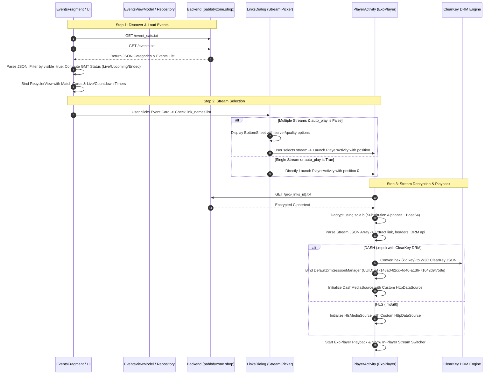

# Live Events Client Architecture & Integration Specification

> **Target Audience:** Android & Mobile Client Engineering Teams  
> **Source App Analyzed:** PlayZ TV (`com.playz.tv`) reverse-engineered with REA & JADX  
> **Purpose:** Blueprint for updating client applications (e.g., GoPlay, OpenStream) using the shared Live Events backend APIs.

---

## 1. High-Level System Architecture & Flow



---

## 2. API Endpoints & Request Flow

Base URL: `https://pabbdyzone.shop/` (configured dynamically via `api_host` in SharedPreferences).

### 2.1 Event Categories: `GET /event_cats.txt`
- **Purpose**: Defines sport and tournament categories for top horizontal filter tabs.
- **Headers**:
  ```http
  User-Agent: Mozilla/5.0 (Linux; Android 10; Pixel 3 XL) AppleWebKit/537.36 (KHTML, like Gecko) Chrome/122.0.0.0 Mobile Safari/537.36
  ```
- **Response Format**:
  ```json
  [
    {
      "cat": "{\"name\":\"All\",\"logo\":\"\"}"
    },
    {
      "cat": "{\"name\":\"Cricket\",\"logo\":\"https://.../cricket.png\"}"
    },
    {
      "cat": "{\"name\":\"Football\",\"logo\":\"https://.../football.png\"}"
    }
  ]
  ```

### 2.2 Live & Upcoming Events: `GET /events.txt`
- **Purpose**: All live, upcoming, and ended sporting events.
- **Response Format**:
  ```json
  [
    {
      "event": "{\"teamAName\":\"India\",\"teamBName\":\"Pakistan\",\"category\":\"Cricket\",\"categoryLogo\":\"\",\"eventName\":\"ICC Men's T20 World Cup\",\"teamAFlag\":\"https://.../ind.png\",\"teamBFlag\":\"https://.../pak.png\",\"eventLogo\":\"https://.../t20.png\",\"links\":\"pro/VDIwIEludGVybmF0aW9uYWwudHh0\",\"date\":\"18/10/2026\",\"time\":\"14:30:00\",\"end_date\":\"18/10/2026\",\"end_time\":\"19:30:00\",\"link_names\":[\"WILLOW HD - AQ\",\"STAR SPORTS 1 HD\"],\"isHot\":true,\"visible\":true,\"hasVpnDetection\":false,\"strokeColor\":\"#FF3B30\",\"priority\":1}"
    }
  ]
  ```
> **Notice**: Each array item wraps the JSON string under the key `"event"`. Your parser must parse the outer array, extract the string at key `"event"`, and parse that into the Event object.

### 2.3 Encrypted Stream Source: `GET /{links}` (e.g. `GET /pro/VDIwIEludGVybmF0aW9uYWwudHh0`)
- **Purpose**: Returns the encrypted stream URLs, DRM keys, and headers for the event.
- **Response Body**: Encrypted substitution ciphertext string (e.g. `mO9eZj...==`).

---

## 3. Data Models

### 3.1 Event Model (`qc.e`)
```kotlin
data class LiveEvent(
    val category: String,           // e.g. "Cricket", "Football"
    val categoryLogo: String?,      // Category icon URL
    val eventName: String,          // Tournament name, e.g. "Premier League"
    val eventLogo: String?,         // Tournament logo URL
    val teamAName: String,          // e.g. "Arsenal"
    val teamBName: String,          // e.g. "Chelsea"
    val teamAFlag: String?,         // Flag or club badge image URL
    val teamBFlag: String?,         // Flag or club badge image URL
    val strokeColor: String,        // Hex card border color, default "#33FFFFFF"
    val date: String,               // Start Date: "dd/MM/yyyy"
    val time: String,               // Start Time: "HH:mm:ss"
    val endDate: String?,           // Optional End Date: "dd/MM/yyyy"
    val endTime: String?,           // Optional End Time: "HH:mm:ss"
    val links: String,              // Relative path to stream payload, e.g. "pro/xxx.txt"
    val linkNames: List<String>,    // Display names of streams, e.g. ["SERVER 1", "SERVER 2"]
    val priority: Int = -1,         // Sorting priority (higher placed first)
    val isHot: Boolean = false,     // Displays flame / "HOT" badge
    val visible: Boolean = true,    // Visibility toggle
    val hasVpnDetection: Boolean = false, // If true, block playback when VPN active
    
    // Runtime computed states
    var status: EventStatus = EventStatus.UPCOMING,
    var isEnded: Boolean = false
)

enum class EventStatus {
    LIVE,
    TODAYS,
    TOMORROW,
    UPCOMING,
    ENDED
}
```

### 3.2 Stream Item Model (`qc.g`)
```kotlin
data class StreamItem(
    val name: String,               // Display name, e.g. "WILLOW HD - AQ"
    val link: String,               // Raw stream URL (may contain pipe headers)
    val api: String?,               // DRM Key / License (hex "kid:key" or JSON)
    val tokenApi: String?,          // Optional token refresh endpoint
    val audio: String? = "pronull", // Alternate audio track URL if present
    val scheme: Int = 0,            // 0 = ClearKey, 1 = Widevine, 2 = PlayReady
    val secureDecoder: Boolean = false, // Secure codec requirement
    val hasHeader: Boolean = false, // Needs custom headers injected
    val hasVpnDetection: Boolean = false // Block if VPN detected
)
```

---

## 4. Decryption Pipeline (`sc.a.b`)

The stream endpoint payload is encrypted using a **custom alphabet substitution cipher followed by Base64 decoding**.

### 4.1 Substitution Alphabets
- **Plain Alphabet ($A$)**:
  `a A b B c C d D e E f F g G h H i I j J k K l L m M n N o O p P q Q r R s S t T u U v V w W x X y Y z Z`
- **Cipher Alphabet ($B$)**:
  `f F g G j J k K a A p P b B m M o O z Z e E n N c C d D r R q Q t T v V u U x X h H i I w W y Y l L s S`

### 4.2 Substitution Logic
Every character in the encrypted string is looked up in the substitution table:
- If character is found in Cipher Alphabet ($B$), it is mapped back to Plain Alphabet ($A$).
- Non-alphabetic characters (e.g., `0-9`, `=`, `+`, `/`, `\n`) are preserved without change.
- The substituted string is then decoded with standard **Base64** to produce the final UTF-8 JSON array string.

### 4.3 Reference Kotlin Implementation
```kotlin
object StreamDecryptor {
    private val PLAIN = "aAbBcCdDeEfFgGhHiIjJkKlLmMnNoOpPqQrRsStTuUvVwWxXyYzZ".toCharArray()
    private val CIPHER = "fFgGjJkKaApPbBmMzZeEnNcCdDrRqQtTvVuUxXhHiIwWyYlLsS".toCharArray()
    
    private val DECRYPT_MAP = CharArray(128) { it.toChar() }

    init {
        for (i in PLAIN.indices) {
            DECRYPT_MAP[CIPHER[i].code] = PLAIN[i]
        }
    }

    fun decrypt(encryptedContent: String): String {
        val trimmed = encryptedContent.trim()
        // If already unencrypted JSON
        if (trimmed.startsWith("[")) return trimmed

        val chars = CharArray(trimmed.length)
        for (i in trimmed.indices) {
            val c = trimmed[i]
            chars[i] = if (c.code < 128) DECRYPT_MAP[c.code] else c
        }

        val substitutedString = String(chars)
        val decodedBytes = android.util.Base64.decode(substitutedString, android.util.Base64.DEFAULT)
        return String(decodedBytes, Charsets.UTF_8)
    }
}
```

### 4.4 Decrypted Payload Output
Decryption yields a standard JSON array of streams:
```json
[
  {
    "name": "WILLOW HD - AQ",
    "link": "https://stream.server.com/live/stream.mpd|User-Agent=Mozilla/5.0...&Referer=https://stream.server.com/",
    "api": "e817c1bf872b4923b7b258a478b05612:a140f28dbbbd377b252062ce53d10ab2",
    "scheme": 0,
    "hasHeader": true,
    "hasVpnDetection": false
  }
]
```

---

## 5. Business Logic & State Computation

### 5.1 GMT Timezone Comparison
Event timestamps are formatted as `dd/MM/yyyy` and `HH:mm:ss`.  
**Critical rule:** All server timestamps must be evaluated against **GMT (UTC)** time, not the user's local phone timezone.

```kotlin
object EventTimeUtils {
    private val gmtDateFormat = SimpleDateFormat("dd/MM/yyyy|HH:mm:ss", Locale.US).apply {
        timeZone = TimeZone.getTimeZone("GMT")
    }

    /**
     * Checks if the event has started and is currently live.
     * Matches PlayZ TV wc.d.p logic.
     */
    fun isLive(dateStr: String, timeStr: String, endDateStr: String?, endTimeStr: String?): Boolean {
        if (isEnded(endDateStr, endTimeStr)) return false
        
        val nowGmt = Calendar.getInstance(TimeZone.getTimeZone("GMT")).time
        val eventStart = parseGmt(dateStr, timeStr) ?: return false
        return !eventStart.after(nowGmt)
    }

    /**
     * Checks if the event has concluded.
     * Matches PlayZ TV wc.d.q logic.
     */
    fun isEnded(endDateStr: String?, endTimeStr: String?): Boolean {
        if (endDateStr.isNullOrEmpty() || endTimeStr.isNullOrEmpty()) return false
        val nowGmt = Calendar.getInstance(TimeZone.getTimeZone("GMT")).time
        val eventEnd = parseGmt(endDateStr, endTimeStr) ?: return false
        return nowGmt.after(eventEnd)
    }

    fun parseGmt(dateStr: String, timeStr: String): Date? {
        return try {
            gmtDateFormat.parse("$dateStr|$timeStr")
        } catch (e: ParseException) {
            null
        }
    }
}
```

### 5.2 Date Tab Categorization
In `nc.b0.java`, events are sorted and distributed into tab buckets:
1. **Ended**: If `isEnded(...) == true`, put in `"Ended"` section.
2. **Live**: If `isLive(...) == true`, put in `"Live"` section.
3. **Today's**: If start date day-of-year matches current day-of-year (in GMT).
4. **Tomorrow**: If start date day-of-year matches (today + 1).
5. **Upcoming**: If start date is beyond tomorrow.

### 5.3 Live Badge vs Countdown Timer Display
In the Event Card ViewHolder (`ic.j.java`):
- **Live Match**:
  - Hides static date/time labels.
  - Displays **Lottie animation** (`lottieAnimationView.setVisibility(View.VISIBLE)`).
  - Starts an elapsed count-up timer showing match duration (`HH:mm:ss`).
- **Upcoming Match (< 24 Hours)**:
  - Displays countdown timer ticking down every second.
  - If $> 1$ hour remaining: shows `HH:mm` format.
  - If $< 1$ hour remaining: shows `mm:ss` ticking countdown.
- **Ended Match**:
  - Shows static "Ended" label in grey.
  - Disables timers and click-to-play if expired.

---

## 6. Stream Selection & BottomSheet Architecture

```
User taps Match Card
   │
   ├──> Check VPN status: if hasVpnDetection && VPN connected -> Show Warning Alert Dialog
   │
   └──> Check link_names list:
           ├──> If link_names.size > 1 AND auto_play == false:
           │       Show LinksDialog (BottomSheetDialogFragment)
           │       User picks Server/Resolution
           │       Launch PlayerActivity(position = selectedIndex)
           │
           └──> If link_names.size == 1 OR auto_play == true:
                   Launch PlayerActivity(position = 0)
```

### Intent Extras Passed to PlayerActivity:
| Extra Key | Type | Description |
|:---|:---|:---|
| `title` | `String` | Display title (e.g. "India vs Pakistan") |
| `links` | `String` | Relative path to encrypted file (e.g. `pro/xxx.txt`) |
| `position` | `Int` | Selected stream index (0-based) |
| `isEncoded` | `Boolean` | `true` (signals stream payload must be decrypted) |
| `isEvent` | `Boolean` | `true` (enables event banner, live timers, and score bar) |

---

## 7. ExoPlayer & Playback Architecture

### 7.1 Stream URL & Pipe Headers Parser
Stream URLs in this API frequently include URL-encoded headers separated by the pipe character `|`:
`https://cdn.example.com/live/master.mpd|User-Agent=Mozilla/5.0...&Referer=https://stream.com/`

```kotlin
fun parseStreamUrl(rawUrl: String): Pair<String, Map<String, String>> {
    val decoded = URLDecoder.decode(rawUrl, "UTF-8")
    if (!decoded.contains("|")) {
        return Pair(decoded, emptyMap())
    }

    val parts = decoded.split("|", limit = 2)
    val streamUrl = parts[0]
    val headers = mutableMapOf<String, String>()

    val queryParams = parts[1].split("&")
    for (param in queryParams) {
        val kv = param.split("=", limit = 2)
        if (kv.size == 2) {
            headers[kv[0]] = kv[1]
        }
    }
    return Pair(streamUrl, headers)
}
```

### 7.2 Custom HttpDataSource Factory
```kotlin
fun buildHttpDataSourceFactory(
    context: Context,
    customHeaders: Map<String, String>,
    hasHeader: Boolean
): DefaultHttpDataSource.Factory {
    val defaultUserAgent = "Mozilla/5.0 (Linux; Android 10; Pixel 3 XL) AppleWebKit/537.36 (KHTML, like Gecko) Chrome/122.0.0.0 Mobile Safari/537.36"
    
    val factory = DefaultHttpDataSource.Factory()
        .setUserAgent(customHeaders["User-Agent"] ?: defaultUserAgent)
        .setAllowCrossProtocolRedirects(true)
        .setConnectTimeoutMs(15000)
        .setReadTimeoutMs(15000)

    val finalHeaders = customHeaders.toMutableMap()
    if (hasHeader) {
        finalHeaders["X-If-Modified"] = (System.currentTimeMillis() / 1000).toString()
    }

    factory.setDefaultRequestProperties(finalHeaders)
    return factory
}
```

### 7.3 ClearKey DRM Hex-to-JWK Conversion (`wc.d.s`)
When `streamItem.api` is present for DASH streams, it contains hex keys:  
`kid_hex:key_hex` (e.g. `e817c1bf872b4923b7b258a478b05612:a140f28dbbbd377b252062ce53d10ab2`).

ExoPlayer's ClearKey DRM requires W3C JSON Web Key (JWK) format:
```kotlin
object ClearKeyUtils {
    /**
     * Converts "hex_kid:hex_key" to W3C ClearKey JSON.
     * Matches PlayZ TV wc.d.s and wc.d.n.
     */
    fun convertHexToClearKeyJson(hexPair: String): String {
        if (hexPair.startsWith("{")) return hexPair // Already JSON

        val tokens = hexPair.split(":")
        val jsonKeys = StringBuilder()

        var i = 0
        while (i < tokens.size) {
            val hexKid = tokens[i]
            val hexKey = tokens.getOrNull(i + 1) ?: break

            val base64Kid = hexToBase64(hexKid).replace("=", "")
            val base64Key = hexToBase64(hexKey).replace("=", "")

            if (jsonKeys.isNotEmpty()) jsonKeys.append(",")
            jsonKeys.append("""{"kty":"oct","k":"$base64Key","kid":"$base64Kid"}""")
            i += 2
        }

        return """{"keys":[$jsonKeys],"type":"temporary"}"""
    }

    private fun hexToBase64(hex: String): String {
        val len = hex.length
        val data = ByteArray(len / 2)
        var i = 0
        while (i < len) {
            data[i / 2] = ((Character.digit(hex[i], 16) shl 4) + Character.digit(hex[i + 1], 16)).toByte()
            i += 2
        }
        return android.util.Base64.encodeToString(data, android.util.Base64.NO_WRAP)
    }
}
```

### 7.4 MediaSource & ExoPlayer Integration
```kotlin
fun buildMediaSource(
    context: Context,
    streamItem: StreamItem
): MediaSource {
    val (cleanUrl, customHeaders) = parseStreamUrl(streamItem.link)
    val httpDataSourceFactory = buildHttpDataSourceFactory(context, customHeaders, streamItem.hasHeader)

    return if (cleanUrl.contains(".mpd")) {
        // DASH Media Source
        val dashFactory = DashMediaSource.Factory(httpDataSourceFactory)
        
        if (!streamItem.api.isNullOrEmpty() && !streamItem.api.contains("http")) {
            val clearKeyJson = ClearKeyUtils.convertHexToClearKeyJson(streamItem.api)
            
            // Build ClearKey DRM Session Manager using LocalMediaDrmCallback
            val drmCallback = LocalMediaDrmCallback(clearKeyJson.toByteArray(Charsets.UTF_8))
            val drmSessionManager = DefaultDrmSessionManager.Builder()
                .setUuidAndExoMediaDrmProvider(C.CLEARKEY_UUID, FrameworkMediaDrm.DEFAULT_PROVIDER)
                .build(drmCallback)
            
            dashFactory.setDrmSessionManagerProvider { drmSessionManager }
        }
        
        val mediaItem = MediaItem.Builder()
            .setUri(Uri.parse(cleanUrl))
            .setMimeType(MimeTypes.APPLICATION_MPD)
            .build()
        dashFactory.createMediaSource(mediaItem)
    } else {
        // HLS Media Source (.m3u8)
        val hlsFactory = HlsMediaSource.Factory(httpDataSourceFactory)
            .setAllowChunklessPreparation(true)
        val mediaItem = MediaItem.Builder()
            .setUri(Uri.parse(cleanUrl))
            .setMimeType(MimeTypes.APPLICATION_M3U8)
            .build()
        hlsFactory.createMediaSource(mediaItem)
    }
}
```

---

## 8. In-Player Stream Switcher (`PlayerActivity.G`)
When an event has multiple streams (`jSONArray.length() > 1`):
1. `PlayerActivity` displays a horizontal `RecyclerView` docked at the bottom of the player.
2. The current stream's button is highlighted (`adapter.selectedPosition = position`).
3. Tapping another stream seamlessly releases the current `MediaSource`, keeps player controllers alive, loads the new stream, and transitions without restarting the activity.

---

## 9. Client Migration Checklist for GoPlay / OpenStream

- [ ] **Repository Layer**:
  - [ ] Implement `EventRepository.getEventCategories()` targeting `GET /event_cats.txt`.
  - [ ] Implement `EventRepository.getEvents()` targeting `GET /events.txt` (parsing nested `"event"` JSON strings).
  - [ ] Add `StreamDecryptor` module matching the substitution table in Section 4.
  - [ ] Implement `EventRepository.getStreams(linksPath: String)` to fetch and decrypt stream payloads.

- [ ] **Domain & Timezone Logic**:
  - [ ] Enforce **GMT** comparison for `isLive()` and `isEnded()`.
  - [ ] Group events into 5 primary categories: `Live`, `Today's`, `Tomorrow`, `Upcoming`, `Ended`.

- [ ] **UI Layer**:
  - [ ] Add top horizontal category chip selector (`All`, `Cricket`, `Football`, etc.).
  - [ ] Update Match Card layout to show: League Logo, Team A Flag + Name, Team B Flag + Name, dynamic card stroke color, and "HOT" badge.
  - [ ] Implement dual-state timer: Lottie animation + count-up elapsed time when live; countdown timer when upcoming (< 24h).
  - [ ] Implement `LinksBottomSheetDialog` for multi-server picker.

- [ ] **ExoPlayer / Video Engine**:
  - [ ] Add pipe header parser (`split("|")`).
  - [ ] Add dynamic `DefaultHttpDataSource.Factory` applying `User-Agent`, `Referer`, and `X-If-Modified`.
  - [ ] Integrate `ClearKeyUtils` hex-to-JWK converter for DASH `.mpd` streams.
  - [ ] Bind `LocalMediaDrmCallback` with `C.CLEARKEY_UUID` (`e47148a0-62cc-4d40-a1d6-71642d9f758e`).
  - [ ] Implement in-player horizontal stream switcher bar.

---

## 10. Flutter Event Card Implementation Specification

For cross-platform Flutter client apps, the exact UI component has been reverse-engineered from `res/layout/item_event.xml` and `ic/j.java`.

The complete drop-in Flutter implementation is saved at:
👉 **[`flutter_event_card.dart`](file:///d:/Poject/Reverse%20engineer%20anything/flutter_event_card.dart)**

### 10.1 Layout Blueprint & Visual Tokens
| Element | XML Source ID / Attribute | Flutter Widget / Style | Value / Hex Code |
|:---|:---|:---|:---|
| **Card Container** | `@id/event_card` | `Container` + `InkWell` | Background: `#121A27`<br>Radius: `10.0`<br>Margin: `3.0` |
| **Card Border** | `app:strokeColor` | `Border.all(width: 1.0)` | Dynamic: `event.strokeColor` (Default: `#33FFFFFF`) |
| **League / Category** | `@id/topLay`, `@id/event_text` | `Row` + `Text` | Font: `13sp`, Bold, White |
| **Tournament Logo** | `@id/event_logo` | `Image.network` | Size: `18x18`, fitCenter |
| **Team A Flag** | `@id/teamAFlag` | `ClipOval` | Size: `38x38` Circular |
| **Team A Name** | `@id/teamAName` | `Text` | Font: `12sp`, Bold, White |
| **Team B Flag** | `@id/teamBFlag` | `ClipOval` | Size: `38x38` Circular |
| **Team B Name** | `@id/teamBName` | `Text` | Font: `13sp`, Bold, White |
| **Center Time Text** | `@id/time_text` | `Text` | Font: `12sp`, White (Local 12h format e.g. `02:30 PM`) |
| **Center Date Text** | `@id/date_text` | `Text` | Font: `13sp`, `#3A5BFE` (`@color/app_color`), Bold |
| **Live Indicator** | `@id/live_anim_view` | `AnimatedBuilder` | Pulse badge / Lottie `45x45` |
| **Status Text** | `@id/status_text` | `Positioned` (Bottom Center) | Font: `11sp`, `#E6E6E6` (`@color/gray_10`) |
| **HOT Badge** | `@id/hotLabel` | `Positioned` (Bottom Right) | Color: `#CC0000`<br>Radius: `topLeft: 20, bottomRight: 10` |

### 10.2 Usage Example in Flutter
```dart
import 'package:flutter/material.dart';
import 'flutter_event_card.dart';

class LiveEventsListScreen extends StatelessWidget {
  final List<LiveEvent> events;

  const LiveEventsListScreen({Key? key, required this.events}) : super(key: key);

  @override
  Widget build(BuildContext context) {
    return ListView.builder(
      padding: const EdgeInsets.symmetric(horizontal: 8.0, vertical: 6.0),
      itemCount: events.length,
      itemBuilder: (context, index) {
        final event = events[index];
        return PlayZEventCard(
          event: event,
          onTap: () {
            // Open stream bottom sheet or navigate to player
          },
        );
      },
    );
  }
}
```

